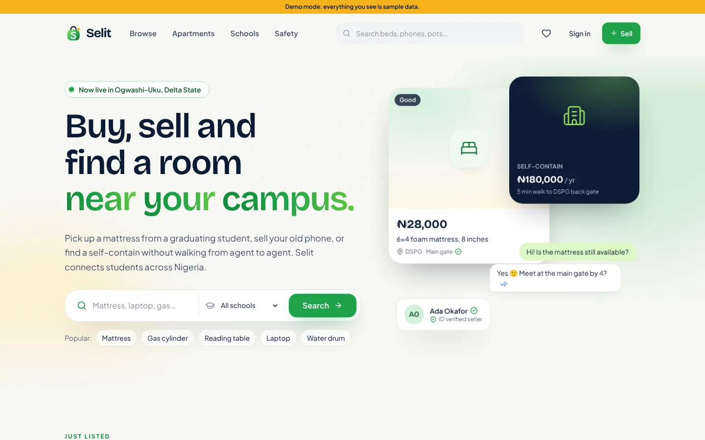
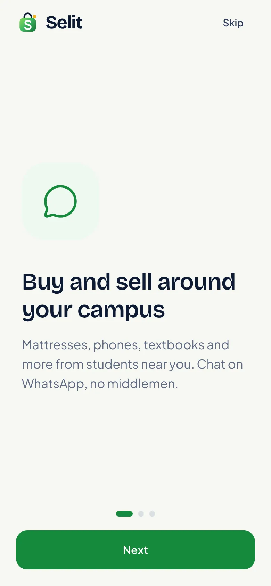
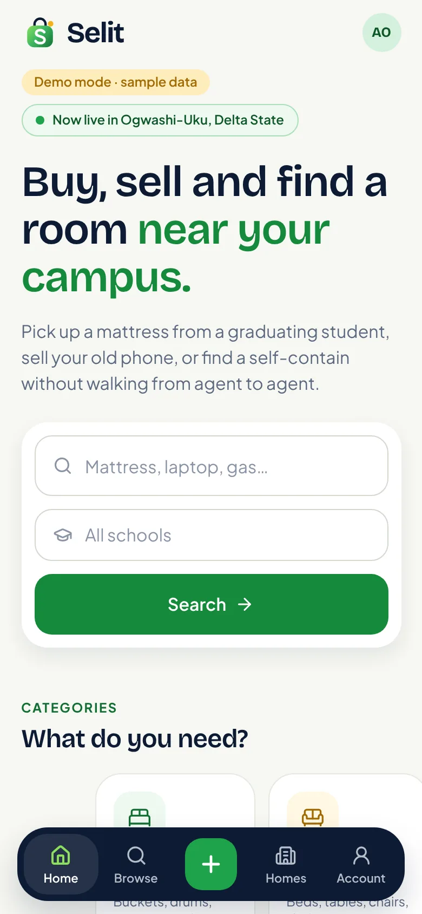
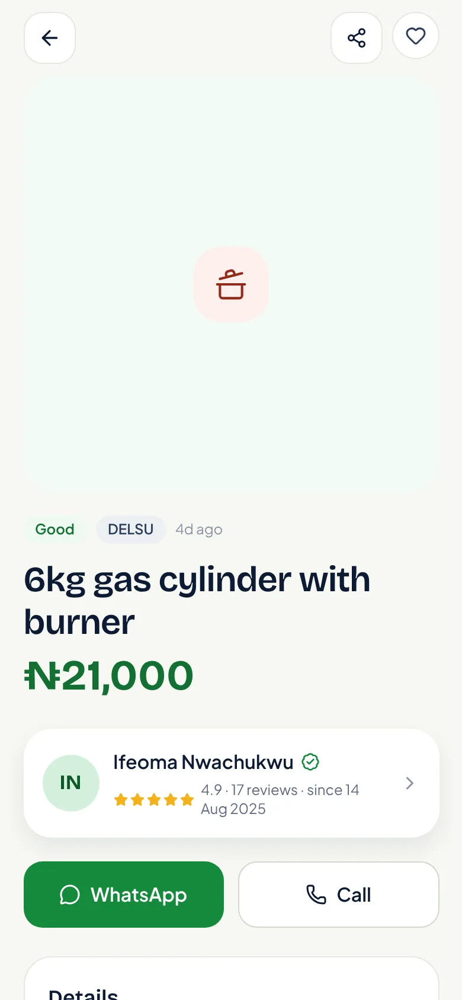
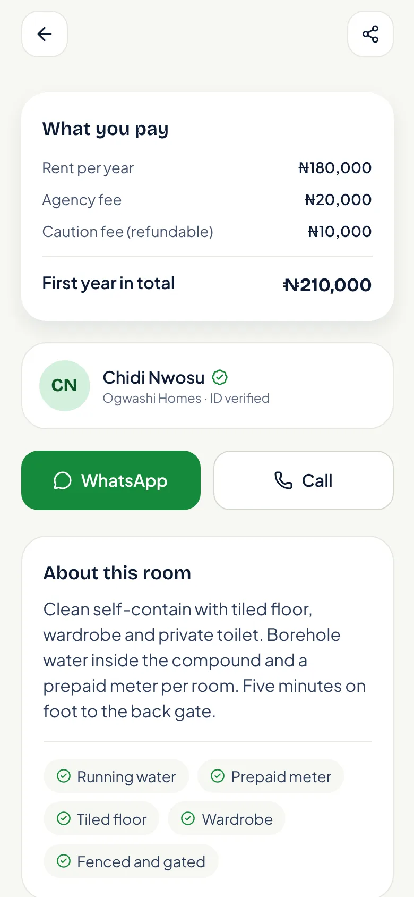
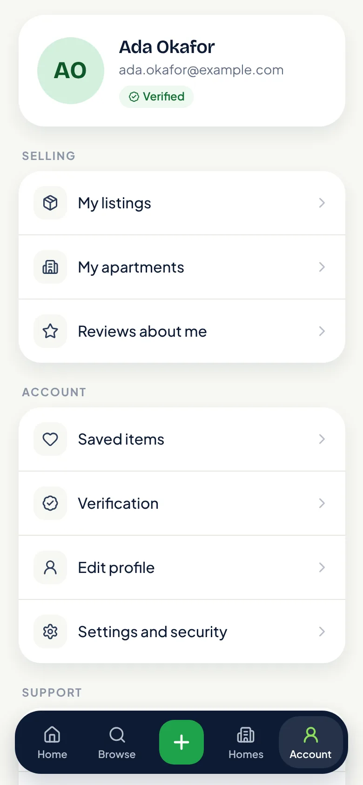

<div align="center">


# Selit

**The student marketplace.** Buy and sell used items and find a room near your campus.
Live in Ogwashi-Uku, Delta State, and ready for every school in Nigeria.

Android · iOS · Web

</div>

<p align="center">
  
</p>

<p align="center">
  
  
  
  
  
</p>

## What it does

- **Buy and sell** hostel items, furniture, phones, textbooks and more, filtered by school, category, condition and budget.
- **Find a room**: self-contains and flats near campus from ID-verified agents, with rent, agency and caution fees shown upfront.
- **Talk directly** on WhatsApp or by phone. Selit never touches the money; you meet, inspect, then pay.
- **385 Nigerian schools**, searchable by name, short name or town, with Delta State first.
- **Reviews and ratings** for sellers, with seller replies and "helpful" votes.
- **Saved items**, share links, and "Share my meet-up" to tell a friend who, where and when.
- **An admin dashboard** for review queues, identity checks, reports, members and categories.

## Built to keep scammers out

| Protection            | How it works                                                                                                                                                                               |
| --------------------- | ------------------------------------------------------------------------------------------------------------------------------------------------------------------------------------------ |
| Verified identities   | ID number, ID photo and a three-frame live selfie, checked by a reviewer. Only the last four characters and a keyed hash of the ID number are kept; photos are deleted after the decision. |
| Bait-price checks     | Listings far below the typical price for their category, and every new seller's first listings, are held for review. New sellers photograph a one-time code beside the item.               |
| Fresh apartments      | Agents must confirm a room is still free every 14 days or it disappears. Students mark rooms "real" or "taken"; three "taken" reports flip it.                                             |
| Members-only contacts | Phone numbers are only sent to signed-in members, so scrapers get nothing.                                                                                                                 |
| Fast reporting        | Three reports take a listing off the feed until an admin decides. Banned members vanish with everything they posted.                                                                       |
| Rules in the database | Row-level security, guard triggers and rate limits run inside Postgres, so a modified app can't skip them.                                                                                 |
| Safe sessions         | Tokens live in the Android Keystore / iOS Keychain. The app locks after five minutes away, with optional fingerprint unlock.                                                               |

## How it is built

```
selit/
├── backend/   Supabase: Postgres schema, rules, row-level security, storage, tests
├── shared/    Types, validation, schools, catalogue and the data layer used by both apps
├── web/       Next.js website
├── mobile/    Expo app for Android and iOS
└── .github/   CI, database deploys, app builds, over-the-air updates, daily housekeeping
```

| Part              | Stack                                                                 |
| ----------------- | --------------------------------------------------------------------- |
| Database and auth | Supabase (Postgres 17, Auth, Storage)                                 |
| Website           | Next.js 16, React 19, Tailwind CSS 4, TanStack Query, Motion          |
| App               | Expo SDK 58, React Native 0.88, Expo Router, NativeWind, Reanimated 4 |
| Shared            | TypeScript, Zod                                                       |

Both apps talk to Supabase through one shared data layer (`shared/src/api`). Without Supabase keys, the same layer serves realistic sample data, so every screen works end to end before launch.

## Run it

Requires Node 20.19 or newer.

```bash
# Website: http://localhost:3000
npm install
npm run dev --workspace web

# App: scan the QR code with Expo Go, or press w for the browser
cd mobile
npm install
npx expo start
```

Copy `web/.env.example` to `web/.env.local` and `mobile/.env.example` to `mobile/.env` and fill in the Supabase URL and anon key. Leave them empty for sample mode.

## Checks

```bash
npm run typecheck          # shared + website
npm run lint               # website
npm test                   # database rules on an in-memory Postgres
cd mobile && npx tsc --noEmit
```

## Ship it

- **Database**: pushing to `main` runs the database tests, then applies new migrations to Supabase.
- **Android APK**: run the **Build Android APK** workflow; the download link appears in the run summary.
- **App updates**: every push that touches the app reaches installed phones over the air.
- **Website**: deploy the `web` folder to Vercel.
- **Housekeeping**: a daily job keeps the free Supabase project awake and clears old photos and records.

First-time setup, step by step: [docs/going-live.md](docs/going-live.md).

## License

All rights reserved.
